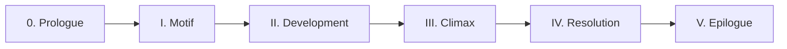

# 《声·命体》视觉系统 PRD v4.1

> **更新日期**: 2026-04-13  
> **当前状态**: 「点、线、面」三维度核心逻辑已集成，视觉回归单色重影特效  
> **核心文件**: `shengmingti_proto_v3.html` (集成版) / `CHAPTER_CONFIG.js` (文案配置)

---

## 1. 核心概念：维度交响 (The Dimension Symphony)

### 1.1 叙事架构：「三维度 × 六阶段」

项目采用**维度（Dimension）**组织叙事。每个维度遵循相同的物理演化六阶段模式：



1. **0. Prologue (序幕)**：虚无，全黑背景。
2. **I. Motif (动机)**：核心几何元素出现。
3. **II. Development (发展)**：产生波动与游走脉冲。
4. **III. Climax (高潮)**：全维度爆发（球体形变/造山/魔方自转）。
5. **IV. Resolution (解决)**：能量释放后的余震与呼吸感。
6. **V. Epilogue (尾声)**：归于寂静。

### 1.2 视觉风格：单色极简 (Monochromatic Minimal)
应甲方要求，取消彩色色散。改用**单色多级偏移 (Monochromatic Ghosting)**：
- **重影效果**：随动能产生 `offset` 偏移，偏移量由 `currentSpeed` 决定。
- **透明度阶梯**：核心线条 100% 亮度，两个偏移重影分别为 40% 和 23% 透明度。
- **质感**：模拟高级镜头的黑白 motion blur，无杂色干扰，强调纯净感。

---

## 2. 章节（维度）详细实现

### 第一章：点 (Point - Curiosity · Exploration)
- **视觉**: `dot-6stages.html`。粒子海 -> 涟漪 -> **星空球体重构**。
- **演变核心**: 粒子从平面坐标系通过数学映射扭转为球极坐标系。

### 第二章：线 (Line - Connection · Touch)
- **视觉**: `line-6stages.html`。直线 -> 游走脉冲 -> **三维造山运动**。
- **演变核心**: FBM 噪声高度随 P 值增加，并开启景深虚化。

### 第三章：面 (Face - Resonance · Dance)
- **视觉**: `face-6stages.html`。平面 -> 九宫偏移 -> **魔方多层自转与穿梭**。
- **演变核心**: 几何方块的轴向旋转逻辑，辅以空间穿梭网格。

---

## 3. 传感器系统与交互逻辑 (技术核心)

### 3.1 BLE 连接配置 (已稳定)

| 设备 | 蓝牙名称 | UUID (服务/特征) | 角色 |
|------|----------|-----------------|------|
| 主手 | `ESP32` | `19b10000...` / `03504231...` | 波形生成、峰值触发 |
| 副手 | `ESP32-mini` | 同上 | 阶段增强、形态解锁 |

### 3.2 峰值检测算法 (Peak Detection)
```javascript
function detectPeak(velocity, isMain) {
  const prev = isMain ? STATE.prevMainVel : STATE.prevSubVel;
  const isRising = velocity > prev * 1.1;      // 上升沿检测
  const overThreshold = velocity > 20;          // 阈值（约2g）
  
  if (isRising && overThreshold) {
    if (isMain) STATE.mainPeaked = true;
    else STATE.subPeaked = true;
    STATE.peakHold = 25;  // 状态保持约 400ms，防止阶段频繁闪动
  }
}
```

### 3.3 强度与阶段调度
根据能量模长 $maxE$ 和双峰值状态决定 Morph 进度：
- **高潮 (P=1.0)**: `hasSub && STATE.mainPeaked && STATE.subPeaked && maxE > 70`
- **发展 (P=0.3~0.7)**: `maxE > 30`
- **平滑插值**: `current += (target - current) * 0.04` (缓解体感数据抖动)

---

## 4. 技术踩坑汇总

### 4.1 渲染层 (Canvas & Three.js)
- **底部填充覆盖 (Legacy)**：2D 绘图时 `ctx.fill()` 会覆盖下层线条，必须改用纯 `ctx.stroke()`。
- **深度写入 (Three.js)**：透明粒子堆合会产生黑色方块。必须设置 `depthWrite: false` 并启用 `AdditiveBlending`。
- **物理时间积分器**：切换倍率时使用 `accumulatedTime` 替代 `delta`，避免切阶段时的“瞬移”Bug。
- **钟形包络 (Bell)**：山脉边缘平滑必须使用 `Math.exp(-Math.pow(nx * 6, 2))`，否则地形会在两端锐利切截。

### 4.2 BLE 交互层
- **蓝牙过滤失败**：副手设备名 `ESP32-mini` 必须与代码完全匹配。
- **数据结构陷阱**：主副手数据必须使用数组 `[ctrl0, ctrl1]` 存储，避免对象 Key 动态生成的索引混乱。
- **内存泄漏**：重连前未清理 `bleDevice = null` 会导致浏览器 Web Bluetooth 栈溢出。

### 4.3 传感器逻辑层
- **桌面震动触发**：传感器放桌上会产生噪声。通过 `velocity > prevVel * 1.1` 上升沿检测可有效过滤环境震动。
- **响应迟钝**：直接用模长会导致反应慢。通过 `peakHold` 保持 400ms 开启状态，能显著提升“随手而动”的打击感。

---
*本文档为《声·命体》核心技术资产，涵盖视觉重构与传感器通信的全量决策。*
